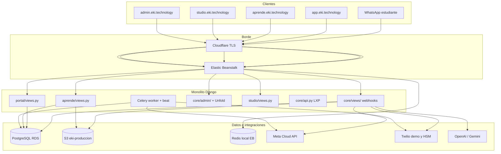
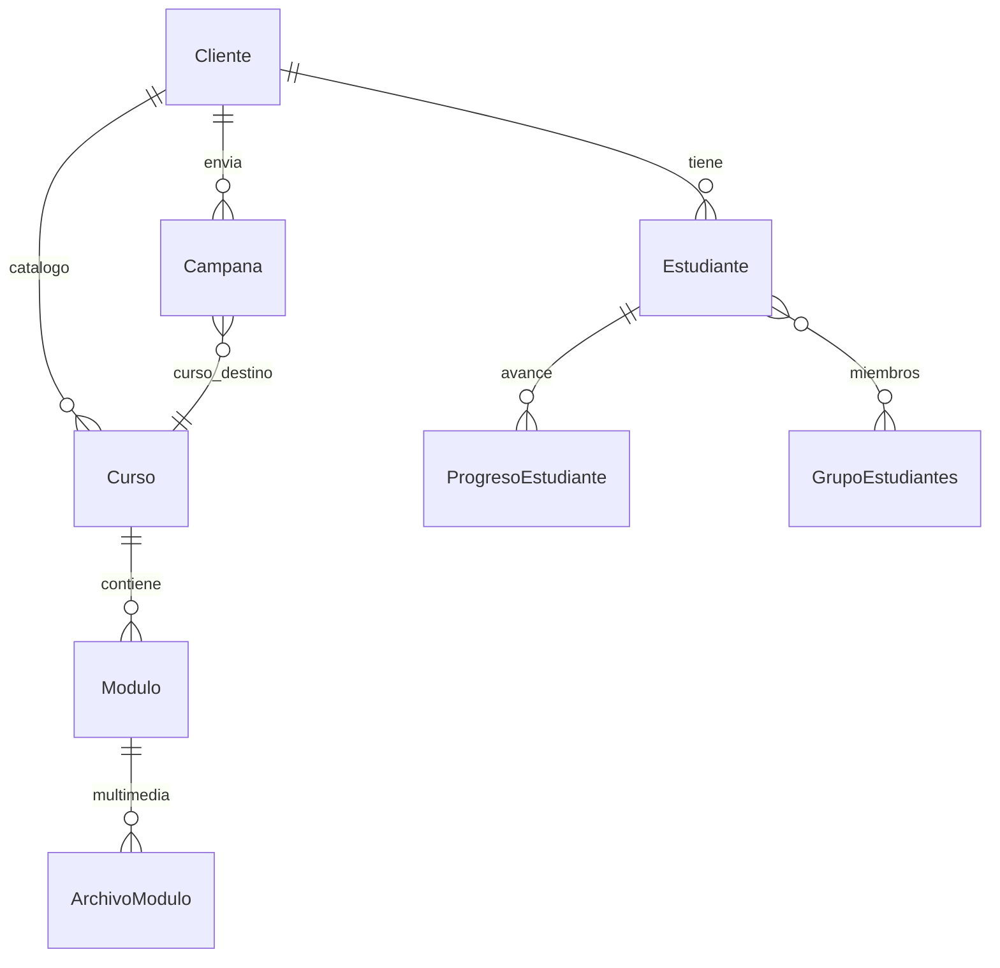

# Auditoría de arquitectura — eki MVP (monolito Django)

Documento de referencia para entender **cómo funciona el código hoy**, su arquitectura, deuda técnica y mejoras recomendadas.  
Última revisión: **3 octubre 2026**. Prod: `eki-prod-final`, deploy `main-20261001-213708`. Rollback: `main-agentes-fallback-20261001-171500`. El mapa de producto (planes, menú, agentes) está en `docs/GUIA_PLATAFORMA_EKI.md` §26. El admin, en `docs/EKI_UNFOLD_ADMIN.md`. El split del webhook, en `docs/REFACTOR_VIEWS.md`.

---

## 1. Resumen ejecutivo

eki es un **monolito Django** desplegado en **AWS Elastic Beanstalk** que orquesta:

| Superficie | URL (prod) | Usuario |
|------------|------------|---------|
| Admin operaciones | `admin.eki.technology` | Staff eki |
| Portal B2B | `app.eki.technology` | Coordinadores de clientes |
| Aula web | `aprende.eki.technology` | Estudiantes y profesores |
| Studio | `studio.eki.technology` | Compra e inscripción (aparte del aula) |
| WhatsApp Meta | Webhook Cloud API | Estudiantes (canal de producto) |
| WhatsApp Twilio | Webhook Twilio | Demo y campañas HSM |

**Canal de producto:** línea **Meta**. Menú Formación / Asesoría según plan de la organización o del grupo (OP1, OP2, OP3). El avance del curso sigue siendo *listo* sobre `ProgresoEstudiante`. Twilio no desapareció: campañas y línea demo. Portal, aula y Studio son superficies distintas sobre los mismos modelos de `core` (Studio tiene además cuentas y pagos propios).

**Estado del monolito:** en producción. `core/views.py` ya es el paquete `core/views/` (mismo comportamiento, deploy `main-20261001-213708`). Lo que sigue grande es `_procesar_twilio_webhook_cuerpo` dentro de `webhook_twilio.py` (~3.500 líneas), más `response_templates.py` y `models.py`. `learning/` sigue siendo proxy, no el dueño de las tablas. El admin es **django-unfold**, no Jazzmin.

---

## 2. Diagrama de arquitectura



---

## 3. Estructura de aplicaciones Django

| App | Rol | Modelos propios | Notas |
|-----|-----|-----------------|-------|
| **core** | Orquestador central | `models.py` (~3.3k líneas), `models_extras.py`, certificados, gamificación | Webhooks, campañas, drip, certificados, RAG, tareas Celery |
| **portal** | Portal B2B clientes | `PortalUsuario`, `PortalFeedback` | Métricas, GEI, Nat, campañas, PQRS, exports |
| **aprende** | Aula web | `TareaCurso`, `EntregaTarea` | Reutiliza `Curso`/`Modulo`/`ArchivoModulo` de core |
| **formulario** | GEI / Preserva | Ficha, flujos, `TipoFormulario.meta_flow_id` | Chat uno a uno; Flow nativo si hay WABA id |
| **studio** | Vitrina y checkout | Cuentas, carrito, orden, Wompi | Aparte de Aprende; handoff firmado |
| **learning** | Bounded context (scaffold) | Proxies a tablas `core` | Migración gradual; las tablas siguen en `core` |
| **agents_edu** | Admin agrupado IA edu | Proxy `DocumentoRAG` | Solo organización admin |
| **agents_commercial** | Bot Nat / comercial | Proxies B2B, RAG comercial | Línea comercial por org; en Meta también entra por el menú |
| **analytics** | Métricas / exports | Proxies `EventoIA`, métricas | Lógica parcial en `core/domains/` |
| **integrations** | Fachada URLs API LXP | Ninguno | Redirige a `core.api` |

**Regla de dependencias deseada:** `aprende`, `portal`, `learning` → `core` → Django/DB. Evitar imports circulares desde `core` hacia apps de presentación.

---

## 4. Enrutamiento y subdominios

Archivo raíz: `mvp_project/urls.py`

```
/health, /healthz          → health check EB
/admin/                    → Django admin (Unfold)
/portal/                   → portal.urls
/aprende/                  → aprende.urls
/studio/                   → studio.urls
/webhook/...               → core.urls.webhook_urls
/admin/dashboard/, drip... → core.urls.admin_urls (vistas custom)
/api/...                   → integrations.urls → core.api
/verificar-certificado/    → certificados públicos
```

**Redirección por host** (`root_redirect`):

| Host | Destino |
|------|---------|
| `app.eki.technology` | `/portal/login/` |
| `admin.eki.technology` | `/admin/` |
| `aprende.eki.technology`, `aula.eki.technology` | `/aprende/` |
| `studio.eki.technology` | Studio |
| Otros | `/admin/` |

Config producción: `EKI_ALLOWED_HOSTS`, `CSRF_TRUSTED_ORIGINS`, `EKI_BEHIND_CLOUDFLARE` en EB.

---

## 5. Flujo WhatsApp (corazón del producto)

Hay **dos entradas**. No se mezclan en el envío.

### 5.1 Línea Meta (producto)

Webhook JSON de Cloud API. Firma: body crudo → HMAC-SHA256 → `hmac.compare_digest` (`core/meta_waba.py`). El turno de menú, cursos y agentes corre dentro de `canal_sandbox_meta()`, que parchea el cliente de Twilio para que el mismo código de lecciones salga por Graph.

Orden de un mensaje:

1. Habeas de la línea, si falta.
2. Plan (`core/planes_linea.py`): persona → grupo activo más nuevo → organización → `LINEA_META_PLAN_DEFAULT` (hoy OP1, para no dejar números en blanco).
3. Menú (`core/sandbox_menu.py`): con un curso abierto este mes entra a ese curso; con dos pregunta cuál; con cero muestra Formación (carrusel) o Asesoría según el plan.
4. Asesoría: Nat, Lina, Profe IA o Ventas. Cupo mensual de preguntas. Memoria en `WhatsappLog`.
5. *listo*: `response_templates` + `module_steps`. Un solo *listo* entrega todas las partes. El segundo, mientras el primero va en camino, no duplica.
6. Espera: reacción ⏳ en el mensaje del usuario y ✅ al responder. No es un mensaje y no gasta cupo.
7. Ficha GEI abierta: el chat (o el Flow, si está publicado) se come el mensaje antes que el tutor.

Graph: `core/sandbox_canal.py` (`enviar_meta`, lista, carrusel, flow).

### 5.2 Línea Twilio (demo y campañas)

`core/twilio_webhook_security.py`: body crudo → `RequestValidator` → `hmac.compare_digest`, y solo entonces se parsea.

1. Destino comercial o sandbox histórico → Nat (`core/bot_comercial/webhook.py`).
2. Si no → flujo educativo (`_procesar_twilio_webhook`): onboarding, *listo*, drip, campañas.
3. Plan demo: `LINEA_DEMO_TWILIO_PLAN` (por defecto OP1). No acumula la racha de la línea Meta.

`WEBHOOK_CELERY_ASYNC` puede encolar el webhook educativo. Nat en la línea comercial también puede ir a Celery.

### 5.3 Archivos clave

| Archivo | Responsabilidad |
|---------|-----------------|
| `core/views/entrada.py` | Puerta única `whatsapp_webhook` (Meta, Twilio, Nat) |
| `core/views/webhook_meta.py` | Línea Meta: `_procesar_meta_webhook`, `_aplicar_sandbox_menu` |
| `core/views/webhook_twilio.py` | Cuerpo educativo Twilio. Una función de ~3.500 líneas. Fase 2: partirla por `estado_chat` |
| `core/views/webhook_comercial.py` | Entrada Nat y `_encolar_bot_comercial_si_async` |
| `core/views/twilio_transporte.py` | Envío segmentado, status callback, encolado educativo |
| `core/views/audio.py` | Transcripción |
| `core/views/media.py` | Proxy y descarga de media |
| `core/views/admin_panel.py` | Vistas de admin que estaban en el mismo archivo |
| `core/views/__init__.py` | Reexporta los nombres. También `_extraer_texto_archivo_simple` desde `core.bot_comercial.webhook` (en el baseline ese import fallaba) |
| `core/sandbox_menu.py` | Menú Meta, Formación, Asesoría, continuar curso del mes |
| `core/sandbox_canal.py` | Graph: texto, botones, lista, carrusel, flow, reacciones |
| `core/planes_linea.py` | OP1 / OP2 / OP3, cupo de cursos y de preguntas |
| `core/sandbox_agentes.py` | Lina, Profe IA, Ventas; memoria y fallback |
| `core/openai_compat.py` | gpt-5: dos intentos si el primero viene vacío o falla |
| `core/rachas_linea.py` | Racha del día, anclada a insignias tipo RACHA |
| `core/cursos_generales.py` | Carrusel desde `catalogo_menu` |
| `core/bot_comercial/webhook.py` | Nat: RAG, router mini/gpt-5, fallback con ficha o cultivo |
| `core/nat_router.py` | Cuándo Nat usa `gpt-5` y cuándo `gpt-5-mini` |
| `core/response_templates.py` | *listo*, partes del módulo, candado de entrega |
| `core/module_steps.py` | Pasos dentro del módulo |
| `core/flujo_whatsapp_b2b.py` | Twilio B2B: campaña + *listo*, sin menú 1-2-3 |
| `formulario/agent.py` + `flow_gei.py` | Ficha Preserva: chat y Flow |
| `core/intent_detector.py` | Palabras clave. `detect_intent` usa subcadena (`si`, `seguir`): «casi» y «perseguir» pueden salir `continuar_leccion`. El *listo* de Twilio no pasa por ahí; usa `_mensaje_indica_listo` |
| `core/drip_schedule.py` | Calendario de módulos |
| `core/services.py` | Campañas masivas |

### 5.4 Plan y curso

| Aspecto | Línea Meta | Twilio demo / campaña |
|---------|------------|------------------------|
| Quién elige el curso | Carrusel de cursos generales, o el que ya abrió este mes | Campaña `curso_destino` o catálogo de la org |
| Cupo | 1 o 2 cursos al mes según OP1/OP2; OP3 no inscribe | El de la demo |
| Asesor | Nat, Lina, Profe IA, Ventas, con tope de preguntas | Nat comercial de la org, aparte |
| Drip | El del curso, igual que en el aula | Igual |

### 5.5 Campañas

- **Modelos:** `Campana`, `EnvioLog`, `Linea`, `CampanaUnica`, `CampanaB2B`
- **Admin:** `core/admin/campanas.py`
- **Ejecución:** `core/services.py` + Celery `enviar_campanas_programadas` (cada 5 min)
- **Portal:** listado/detalle en `portal/views.py`

---

## 6. Portal B2B (`app.eki.technology`)

### Autenticación

- Usuario Django **no staff** + modelo `PortalUsuario` (rol: admin, profesor, viewer…)
- Sesión: `portal_usuario_id`
- Middleware `SuscripcionMiddleware` bloquea si suscripción vencida

### Módulos (gating por producto)

`portal/capabilities.py` — productos por cliente: `cursos`, `gei`, `nat`, `empleabilidad`.

### Rutas principales (`portal/urls.py`)

- Dashboard, métricas ejecutivas, gamificación, empleabilidad
- GEI: listados, export, editor de formularios (`portal/gei_service.py`)
- Nat comercial: documentos RAG (`portal/nat_service.py`)
- Campañas, conversaciones, timeline estudiante
- Estudiantes, cursos, flujo visual (`curso_flujo_service.py`)
- Certificados, PQRS, perfil organización, branding

**Archivo pesado:** `portal/views.py` (~1.1k líneas) — candidato a split por dominio.

---

## 7. Aula web (`aprende.eki.technology`)

Separada del portal B2B; comparte modelos de `core`.

### Autenticación

| Rol | Mecanismo |
|-----|-----------|
| Estudiante | Escribe *aula* en WhatsApp, pega el código y crea clave; después documento + clave. Sesión `aprende_estudiante_id` |
| Profesor | Login del portal (`PortalUsuario` rol profesor o admin) |

### Servicios

| Archivo | Función |
|---------|---------|
| `aprende/catalogo_service.py` | Catálogo Platzi, inscripción |
| `aprende/acceso_modulos.py` | Visibilidad módulos (misma lógica drip que WA) |
| `aprende/lesson_service.py` | CRUD lecciones + `ArchivoModulo` |
| `aprende/tarea_service.py` | Tareas Moodle-style, calificación 1-5 |
| `aprende/biblioteca_service.py` | Biblioteca multimedia liberada |

### Rutas (`aprende/urls.py`)

```
/aprende/                           inicio
/aprende/estudiante/login/          login estudiante
/aprende/estudiante/                mis cursos
/aprende/estudiante/biblioteca/     multimedia WA reunida
/aprende/estudiante/curso/<id>/     módulos + tareas
/aprende/profesor/                  cursos de la org
/aprende/profesor/curso/<id>/modulo/nuevo/  subir contenido
/admin/aula-web/                    hub admin (views_admin.py)
```

**Contenido del profesor** = mismos `Modulo` + `ArchivoModulo` que WhatsApp (S3). No hay duplicación de almacén.

---

## 8. Modelos de datos

### Capas

```
core/models.py          Cliente, Estudiante, Curso, Modulo, PasoModulo,
                        Campana, ProgresoEstudiante, drip, RAG, empleabilidad…
core/models_extras.py   GrupoEstudiantes, ArchivoModulo, PQRS, EnvioProgramado
core/models_certificados.py
core/gamificacion.py    PerfilGamificacion, Badge, puntos (aún en core)
aprende/models.py       TareaCurso, EntregaTarea
portal/models.py        PortalUsuario
formulario/models.py    GEI + meta_flow_id
studio/models.py        Cuentas, carrito, orden
learning/models.py      Proxies (migración futura)
```

### Entidades centrales del negocio



**Migraciones:** 110+ en `core/migrations/`. `learning/` aún no posee tablas propias.

---

## 9. Admin Django

### Package `core/admin/` (split desde monolito `admin.py`)

| Módulo | Contenido |
|--------|-----------|
| `clientes.py` | Organizaciones B2B |
| `estudiantes.py` | Estudiantes, acciones masivas (~1.6k líneas) |
| `campanas.py` | Campañas, logs |
| `cursos.py` | Cursos, módulos, pasos (~1.2k líneas) |
| `grupos.py` | Grupos de estudiantes |
| `certificados.py` | Plantillas y envío |
| `gamificacion.py` | Badges, puntos |
| `commercial.py` | RAG Nat, productos |

**UI:** django-unfold 0.91 (`mvp_project/unfold_admin.py`). Jazzmin está retirado. Inicio: `templates/admin/partials/eki_panel_exec.html`. Campos de producto de octubre: plan Meta en Cliente (Datos y logo) y en Grupo; `catalogo_menu` en Curso; `meta_flow_id` en el tipo de formulario; insignias RACHA; conocimiento de agentes. Ver `docs/EKI_UNFOLD_ADMIN.md`.

**Vistas admin no-modelo:** `core/urls/admin_urls.py` — dashboard, drip estudiantes, gamificación manual, cobertura, knowledge studio, envío certificados, aula-web.

---

## 10. Drip, certificados, gamificación

| Dominio | Ubicación principal |
|---------|---------------------|
| **Drip calendario** | `core/drip_schedule.py`, modelos `HabilitacionModulo*` |
| **Drip admin UI** | `core/views_drip_estudiantes.py` |
| **Reenganche drip** | Celery `reenganche_drip_content_diario` |
| **Pasos módulo** | `core/module_steps.py` (~705 líneas) |
| **Certificados** | `core/certificado_service.py`, `core/models_certificados.py` |
| **Verificación pública** | `/verificar-certificado/<codigo>/` |
| **Gamificación** | `core/gamificacion.py`, signals, admin ajuste manual |
| **Racha línea Meta** | `core/rachas_linea.py` + insignias tipo RACHA (no es un mensaje aparte) |

---

## 11. Integraciones externas

| Servicio | Uso | Config |
|----------|-----|--------|
| **Meta Cloud API** | Línea de producto: menú, cursos, agentes, flow | `WHATSAPP_TOKEN`, `WHATSAPP_PHONE_ID`. Falta `WHATSAPP_BUSINESS_ACCOUNT_ID` (sin eso no se publica el Flow) |
| **Twilio** | Demo, campañas HSM, Content API | `TWILIO_*` |
| **AWS S3** | Media módulos, certificados, tareas aula | `USE_S3`, bucket `eki-produccion` |
| **PostgreSQL RDS** | BD producción | `DATABASE_URL` |
| **Redis** | Broker Celery en EB (localhost) | `.ebextensions/03_redis.config` |
| **OpenAI** | Agentes: `gpt-5-mini` (chat), `gpt-5` (Nat técnico), `gpt-5-nano` (router) | `OPENAI_API_KEY`, `BOT_COMERCIAL_OPENAI_MODEL*` |
| **Cloudflare** | TLS, subdominios | `EKI_BEHIND_CLOUDFLARE` |
| **SendGrid / Gmail** | Email certificados, soporte | env |

**API LXP** (`core/api.py` ~994 líneas): endpoints para Angular/LXP; estudiante por teléfono.

---

## 12. Tareas asíncronas (Celery)

`mvp_project/celery.py` + `core/tasks.py`

| Tarea | Frecuencia | Función |
|-------|------------|---------|
| `enviar_campanas_programadas` | Beat 5 min | Campañas con `fecha_programada` |
| `sincronizar_plantillas_meta` | Beat 10 min | Estado de plantillas Meta |
| `generar_reporte_actividad` | Beat 1 h | Reporte de actividad |
| `reenganche_drip_content_diario` | Beat diario **08:00** `America/Bogota` | Recordatorio cuando el drip liberó el siguiente módulo |
| `limpiar_logs_antiguos` | Beat diario 02:00 | Limpieza |
| `revisar_infra_advisor` | Cada hora a :15 | Snapshot de infra |
| `correlacionar_alertas_territoriales` | Cada hora a :20 | Alertas territoriales |
| `procesar_twilio_webhook_async` | On demand | Webhook educativo sin bloquear Gunicorn. Importa `core.views` dentro de la tarea |
| `procesar_bot_comercial_webhook_async` | On demand | Nat. Importa `core.views` dentro de la tarea |
| `procesar_sandbox_meta_async` | On demand | Línea Meta fuera del request |
| `ejecutar_campana_async` | On demand | Envío masivo |
| `actualizar_gamificacion_async` | On demand | Puntos/badges |

**Procfile:** web (Gunicorn gthread) + `worker` + `worker_rag` + `beat`. En el deploy `main-20261001-213708` los cuatro quedaron activos y el ping de Celery vio la tarea de Nat. No hay `ImportError` de ciclo: `webhook.py` y `tasks.py` importan `core.views` dentro de funciones. No existe una tarea de reenganche a las 09:00.

---

## 13. Despliegue

| Componente | Detalle |
|------------|---------|
| Plataforma | AWS Elastic Beanstalk `eki-prod-final` |
| Settings prod | `mvp_project/settings_production.py` |
| Migraciones | `.platform/hooks/predeploy/02_migrate.sh` |
| Estáticos | WhiteNoise manifest |
| Health | `/health/` |
| Scripts | `scripts/eb_deploy_main.ps1`, `docs/CHECKLIST_PRE_DEPLOY.md` |

**Dominios prod:** `admin`, `app`, `aprende` en `eki.technology`.

---

## 14. Testing

~65 archivos de test, concentrados en `core/tests_*.py`.

| Área | Cobertura |
|------|-----------|
| Línea Meta: planes, menú, carrusel, agentes, flow | Buena en lo nuevo (`tests_planes_linea`, `tests_sandbox_menu_event_engine`, `formulario/tests_flow_gei`) |
| WhatsApp B2B, listo/continuar | Buena (`tests_flujo_whatsapp_b2b`, `tests_listo_continuar_trigger`) |
| Module steps, drip | Buena (`tests_module_steps`, `tests_drip_matriz`) |
| Certificados | Buena |
| Portal, GEI, Nat | Media |
| Aprende (aula) | Media (`aprende/tests.py`) |
| Admin package split | Básica (`tests_admin_package`) |

### Huecos importantes

- `core/views/` — el paquete se movió sin reescribir. La comparación contra el baseline `56929af7` está en `scripts/baseline_failures_before.txt`. Esos fallos ya existían antes del split (admin search, guardar reto, pausa Carlos, estudiante en admin, PDF del builder, drip de fin de módulo 1, confirmación de datos sin el título del módulo, `detect_intent` por subcadena, foto Nat porque `core.nat_cuota` no existe, y un bloque de tests de portal). `test_onboarding_natural.py` está en `.gitignore`; copiado al baseline falla igual: el primer «sí» pide habeas, y el test espera «nombre completo».
- Firma Twilio y firma Meta — implementadas (body crudo + `compare_digest`) y con tests; no volver a comparar con `==`
- `patch('core.views.X')` pega en el módulo donde el caller busca el nombre, no en el reexport de `__init__.py`. El audio del menú sandbox se parchea en `core.views` y en `core.views.legacy` (`84e80f91`)
- Celery beat — el schedule está en `celery.py`; el proceso quedó vivo en el deploy. Poco testeado el contenido de cada tarea
- `integrations/`, `agents_*`, `learning/` — sin tests
- E2E portal + aula + WA en un solo flujo — parcial
- `pytest.ini` no recoge `tests_*.py` (solo `tests.py` y `test_*.py`). La lista de fallos de pytest del baseline se armó con `python_files=tests_*.py test_*.py`

**Comando mínimo pre-deploy** (ver `docs/CHECKLIST_PRE_DEPLOY.md`):

```bash
python manage.py check
python manage.py test core.tests_flujo_whatsapp_b2b aprende.tests core.tests_admin_package
```

---

## 15. Deuda técnica — archivos críticos

| Archivo | Líneas | Riesgo |
|---------|--------|--------|
| `core/views/webhook_twilio.py` | ~3.490 | El god object se movió aquí: `_procesar_twilio_webhook_cuerpo` sigue siendo una función |
| `core/views/admin_panel.py` | ~1.400 | Dashboards que salieron del mismo archivo |
| `core/models.py` | ~3.355 | Modelos monolíticos |
| `core/response_templates.py` | ~1.806 | Lógica de negocio mezclada con copy |
| `portal/views.py` | ~1.129 | Muchas responsabilidades |
| `core/api.py` | ~994 | API LXP + integración junta |
| `core/certificado_service.py` | ~856 | PDF + S3 + WA |
| `core/module_steps.py` | ~705 | Motor de pasos complejo |
| `core/admin/estudiantes.py` | ~1.600 | Admin muy cargado |

### Deuda estructural

1. **`learning/`** — scaffold; tablas siguen en `core`
2. **`integrations/`** — solo URLs, sin capa de dominio
3. **`agents_*` / `analytics`** — proxies admin, no bounded contexts reales
4. **`core/domains/`** — iniciado (`analytics`, `learning/checkpoints`) pero incompleto
5. **Split admin** — hecho. **Split `core/views.py` → `core/views/`** — hecho el 1 de octubre de 2026 (movimiento, commits `a0f6790e` … `225609d1`, deploy `main-20261001-213708`). **Fase 2** — pendiente: partir `_procesar_twilio_webhook_cuerpo` por `estado_chat`, con tests de caracterización. Eso sí cambia la forma del código; el split no lo hizo.
6. **`detect_intent` por subcadena** — pendiente, commit aparte. No es regresión del split. Meta lo llama; el *listo* de Twilio no.
7. **SQLite local** — se desincroniza fácil si RDS no alcanza; no es entorno fiel

---

## 16. Seguridad — hallazgos

| Hallazgo | Severidad | Ubicación |
|----------|-----------|-----------|
| API LXP: si `INTEGRACION_API_REQUIRE_KEY` está apagado y la key va vacía, la puerta no exige clave | Alta si el flag no está en prod | `core/api.py` |
| Flow de Preserva no se publica: falta `WHATSAPP_BUSINESS_ACCOUNT_ID` | Media (el chat sí responde) | env EB + `formulario/flow_gei.py` |
| Aula: entra con código *aula* y clave, no con OTP en frío | Media (aceptable) | `aprende/` |
| `ALLOWED_HOSTS=['*']` si env no seteado en prod | Media | `settings_production.py` |
| S3 `public-read` + URLs sin firma | Media (requerido por WA) | settings |
| `SECRET_KEY` fallback inseguro en dev | Baja (dev) | `settings.py` |
| `@csrf_exempt` en webhooks | Esperado | webhooks |

Documento relacionado: `PLAN_SEGURIDAD_TWILIO.md` (si existe en repo).

---

## 17. Mejoras recomendadas (monolito sano)

Prioridad para mantener un monolito **bueno** sin microservicios prematuros.

### P0 — Estabilidad y seguridad (1-2 semanas)

1. **Cargar `WHATSAPP_BUSINESS_ACCOUNT_ID`** para que el Flow de Preserva se publique. Hasta entonces el chat es el camino real.
2. **Confirmar `INTEGRACION_API_REQUIRE_KEY` en prod** para que la API LXP no quede abierta si la key está vacía.
3. **Asignar planes OP1/OP2/OP3** y, cuando estén, quitar `LINEA_META_PLAN_DEFAULT` para que un número sin plan no reciba la línea.

### P1 — Mantenibilidad (Fase A refactor)

1. **Fase 2 de `core/views/webhook_twilio.py`:** partir `_procesar_twilio_webhook_cuerpo` por `estado_chat`. Hace falta tests de caracterización antes. No mezclarlo con un movimiento.
2. **`detect_intent`:** comparar palabras completas (`(?<!\w)…(?!\w)`), no subcadenas. Antes, confirmar que `texto_limpio` ya va en minúsculas y sin tildes, y qué hace Meta si llega `continuar_leccion` con una evaluación A–D abierta.
3. **Extraer servicios** de `response_templates.py` → `core/whatsapp_responses/` por intent
4. **Split `portal/views.py`** por módulo (gei, campanas, metricas)
5. **Congelar regla**: nueva lógica en `services/`, views solo orquestan. Un archivo nuevo de `core/views/` tiene que estar en git: `eb deploy` empaqueta `HEAD` (`sc: git`). Un módulo sin trackear no sube y el web arranca con `ImportError`.

### P2 — Arquitectura de dominio (2-3 meses)

1. **Completar `learning/`**: mover gamificación, exámenes, progreso
2. **Unificar drip** — una sola API (`drip_schedule`) usada por WA, portal y aula (ya avanzado en aula)
3. **Eventos internos** — ampliar `EventoIA` / signals para desacoplar certificados y gamificación
4. **No duplicar puertas de menú** — la línea Meta entra por `sandbox_menu.py`; Twilio B2B por `flujo_whatsapp_b2b.py`. No volver a un menú 1-2-3 en Meta.

### P3 — Operaciones

1. **Observabilidad**: métricas webhook latency, errores 500, cola Celery
2. **Tests de humo post-deploy** automatizados (health + login portal + saludo WA mock)
3. **Staging EB** o entorno preview antes de prod
4. **Redis gestionado** (ElastiCache) si Celery crece

---

## 18. Mapa mental: “¿Dónde toco X?”

| Quiero cambiar… | Archivo(s) |
|-----------------|------------|
| Respuesta WA a *listo* | `response_templates.py`, `module_steps.py`, candado en `core/views/webhook_twilio.py` |
| Menú de la línea Meta | `sandbox_menu.py`, `planes_linea.py`, `cursos_generales.py`, puerta `core/views/webhook_meta.py` |
| Entrada del webhook | `core/views/entrada.py` (`whatsapp_webhook`) |
| Nat comercial (encolar) | `core/views/webhook_comercial.py`, `core/bot_comercial/webhook.py` |
| Transcripción de nota de voz | `core/views/audio.py`. El menú la importa desde `core.views` |
| Menú Twilio B2B | `flujo_whatsapp_b2b.py` |
| Campaña masiva | `core/services.py`, `admin/campanas.py`, `tasks.py` |
| Qué módulo ve el estudiante | `drip_schedule.py`, admin drip estudiantes |
| Certificado PDF | `certificado_service.py`, `admin/certificados.py` |
| Portal métricas | `portal/views.py`, `portal/metricas_ejecutivas.py` |
| Aula estudiante | `aprende/views.py`, `acceso_modulos.py` |
| Profesor sube PDF | `aprende/lesson_service.py` → `ArchivoModulo` |
| Grupos y plan del grupo | `admin/grupos.py`, `GrupoEstudiantes.plan_linea_meta` |
| Plan de la organización | `Cliente.plan_linea_meta` en Datos y logo |
| Nat, Lina, Profe IA, Ventas | `sandbox_agentes.py`, `bot_comercial/webhook.py`, `openai_compat.py` |
| Ficha Preserva | `formulario/agent.py`, `formulario/flow_gei.py` |
| Carrusel de Formación | `cursos_generales.py`, `Curso.catalogo_menu` |

---

## 19. Qué está en producción (3 octubre 2026)

Deploy: `main-20261001-213708`. Rollback: `main-agentes-fallback-20261001-171500`.

El 1 de octubre, después del deploy de agentes (`main-agentes-fallback-20261001-171500`), subió el paquete `core/views/`. Health 200. Worker, `worker_rag` y beat arrancaron. El ping de Celery registró `procesar_bot_comercial_webhook_async`. En los logs de ese arranque no hubo `ImportError` ni `NameError`.

El split es movimiento: los nombres públicos siguen importándose como `core.views.<nombre>`. `__init__.py` además reexporta `_extraer_texto_archivo_simple` (subir un `.docx` en Nat), que en el archivo único no existía. La Fase 2 del cuerpo Twilio no está desplegada. `detect_intent` por subcadena tampoco se tocó.

Sigue en prod, del ciclo anterior:

- Planes OP1/OP2/OP3 en cliente y en grupo. Default temporal de la línea Meta = OP1.
- Menú que continúa el curso del mes en vez de reabrir el carrusel.
- Carrusel armado desde cursos generales con `catalogo_menu`.
- *listo* único y módulos de varias partes completos.
- Reacción ⏳ → ✅. Racha dentro del primer mensaje del día.
- Nat, Lina, Profe IA y Ventas con segundo intento y respuesta del mismo tema si el modelo falla.
- Código del Flow de Preserva. **No publica** hasta cargar el id de la cuenta de WhatsApp; el chat sí funciona.

Lo de junio (biblioteca, drip del aula, split del admin, Unfold) ya no está pendiente. Jazzmin no está.

---

## 20. Conclusión

eki sigue siendo **un monolito**: un deploy sirve la línea Meta, Twilio, portal, aula, Studio y admin. Los cursos viven en `core` y el aula los lee; no hay una segunda copia del contenido.

La línea de producto ya no es el webhook Twilio de 2025. Es Meta: plan, menú, carrusel, *listo* y cuatro agentes, con Twilio como demo y campañas. `core/views.py` dejó de ser un solo archivo. La debilidad que queda en el webhook es el tamaño de `_procesar_twilio_webhook_cuerpo`, el de las plantillas, `detect_intent` por subcadena, y el hueco operativo del id de la cuenta de WhatsApp para el formulario nativo.

La estrategia no cambió: refactor por capas, sin microservicios, y sin mezclar Aprende con Studio ni con el portal.

---

*Generado como auditoría interna. Para checklist de deploy ver `docs/CHECKLIST_PRE_DEPLOY.md`.*
