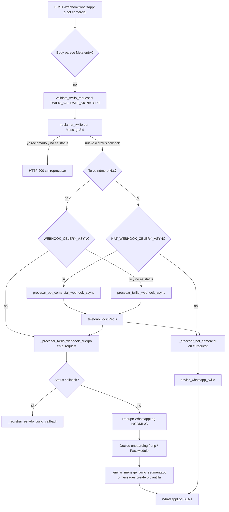
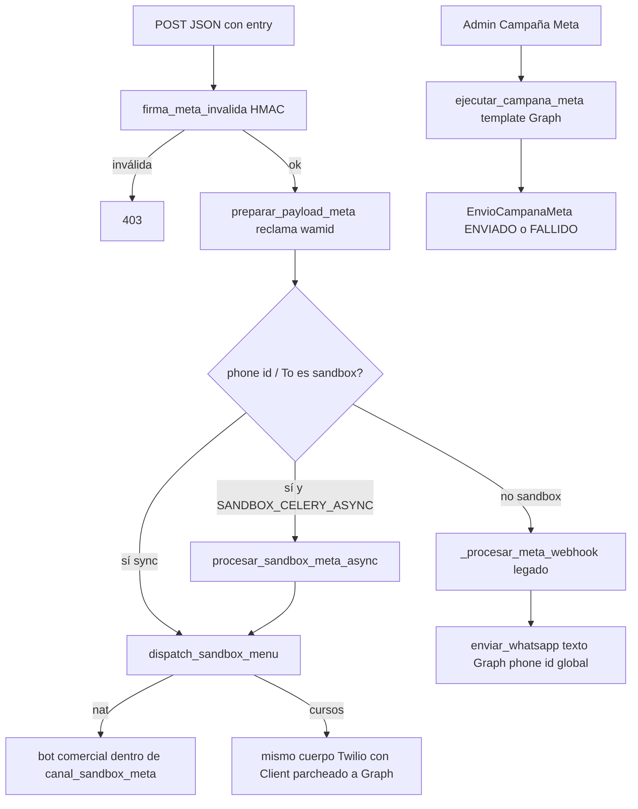

# 01 — Mapa de la capa de envíos

Lectura estática del repo. No se ejecutó la aplicación ni se consultó producción.
Teléfonos y Content SID reales del fuente están redactados en los volcados `02*`.

## Árbol del alcance

| Ruta | Líneas (archivo) | Responsabilidad |
|---|---:|---|
| `core/utils.py` | 82–453 | Tres salidas: plantilla Twilio, sesión Twilio (segmentada) y texto Meta Cloud API (`requests.post`). |
| `core/whatsapp_service.py` | 1–406 | Plantillas Twilio de onboarding (habeas, menú, cursos). `from_` fijo. `enviar_video_whatsapp` es `pass`. |
| `core/enviar_plantillas.py` | 1–259 | Otra copia de envío de Content Template + campaña secuencial + alta/listado de templates Twilio. |
| `core/views/twilio_transporte.py` | 1–308 | Segmentación usada por el webhook educativo, status callback, encolado Celery edu. |
| `core/views/webhook_twilio.py` | 1–3648 | Procesador educativo. Una función de ~3617 líneas decide y envía. |
| `core/views/entrada.py` | 1–284 | `whatsapp_webhook`: GET verify Meta, POST Twilio o Meta, firma, reclamo de id, encolado. |
| `core/views/webhook_comercial.py` | 1–73 | Webhook Nat (`bot_comercial_webhook`) y encolado Celery. |
| `core/views/webhook_meta.py` | 1–175 | Menú sandbox, dedupe cache, procesador Meta legado que llama `enviar_whatsapp`. |
| `core/sandbox_canal.py` | 33–717 | Transporte Graph del sandbox (texto, media, botones, lista, carrusel, flow) y parche de `twilio.rest.Client`. |
| `core/meta_waba.py` | 37–169, 546–656 | HTTP Graph, firma HMAC, campaña de plantillas Meta, hilo daemon si no hay Celery. |
| `core/meta_templates.py` | 1–159 | Alta de message templates en el WABA (no envía al usuario). |
| `core/webhook_evento.py` | 1–186 | Idempotencia `WebhookEventoProcesado` / `WebhookFallido`. |
| `core/locks.py` | 1–95 | Candado Redis por teléfono y contador de reentregas. |
| `core/tasks.py` | 28–463, 907–927 | Reenganche drip, webhooks async, campañas, notificación async. |
| `core/services.py` | 1–177 | Campaña Twilio masiva + fallback a `threading.Thread` daemon. |
| `mvp_project/celery.py` | 27–63 | Beat: campañas 5 min, plantillas Meta 10 min, reenganche drip 08:00. |
| `core/drip_schedule.py` | 1–299 | Días de espera y calendario de módulo. No envía. |
| `core/views/ventana_drip.py` | 1–68 | Ventanas de fechas de features del cliente (no es la ventana de 24 h de WhatsApp). |
| `core/module_steps.py` | 749–915 | Arma el texto del siguiente `PasoModulo`. El webhook lo manda. |
| `core/response_templates.py` | 1249–~1320 | `select_for_update` del estudiante para no entregar dos veces el mismo *listo*. |
| `core/bot_comercial/webhook.py` | 807–1319, envío ~1247 | Nat. Sale por `enviar_whatsapp_twilio` con `from_number`. |
| `core/bot_comercial_routing.py` | 1–86 | Elige Nat vs educativo por el `To`. |
| `core/wa_reply_context.py` | 1–25 | ContextVar del número de respuesta. Se copia a `_eki_reply_from` y nadie lo vuelve a leer. |
| `core/twilio_webhook_security.py` | 1–112 | Firma Twilio (`RequestValidator`) antes de procesar. |
| `core/mensajes_push.py` | 1–97 | Push masivo secuencial (plantilla o texto). |
| `core/certificado_service.py` | 661–887 | Reintentos de diploma y plantilla Twilio. |
| `core/certificado_presencial_service.py` | 77–108, 461–763 | Plantillas de certificado presencial. |
| `portal/utils.py` | 55–79 | Envío Twilio directo del portal (sin log). |
| `formulario/whatsapp_gei.py` | 1–38 | Balance GEI vía `enviar_whatsapp_twilio`. |
| `core/seguimiento_proactivo.py` | 46–103 | Motivación. No hay Beat que lo llame en `mvp_project/celery.py`. |
| `core/models.py` | Campana 1021, EnvioLog 1165, WhatsappLog 1180, Modulo 2442, PasoModulo 2742, Progreso 2912 | Estado de campaña, log de chat y progreso de pasos. |
| `core/models_campana_meta.py` | CampanaMeta 317, EnvioCampanaMeta 391 | Campaña Cloud API. |
| `core/models_extras.py` | EnvioProgramado 103, EnvioMensajePush 852 | Programación y log de push. |
| `core/security_handler.py` | ~499, ~752 | PQRS llama `enviar_whatsapp` (Graph), no Twilio. |
| `core/gamificacion_actions.py` | ~522 | Logro académico también llama `enviar_whatsapp` (Graph). |
| `core/admin/estudiantes.py` | ~542–659 | Megáfono: intenta ventana 24 h y luego `enviar_whatsapp`. |

`core/management/commands/`: grep `enviar_whatsapp|messages.create|enviar_template` → **NO ENCONTRADO** un command que envíe WhatsApp. El cron de envío está en Celery Beat (`mvp_project/celery.py:27`).

## Flujo Twilio

En producción (`mvp_project/settings_production.py:448-456`) los tres flags `*_CELERY_ASYNC` nacen en True salvo que el env los apague. En `mvp_project/settings.py:1008-1012` el default es False.

## Flujo Meta

Hay tres caminos distintos. No comparten una interfaz con Twilio.

`sandbox_meta_activo()` (`core/sandbox_canal.py:45`) hace que `enviar_whatsapp_twilio` y `enviar_template_twilio` dejen Twilio y hablen con Graph. `MetaOutboundClient` (`core/sandbox_canal.py:66`) sustituye `twilio.rest.Client` durante ese turno, así que los `messages.create` del webhook educativo salen por Meta sin cambiar el webhook.

## Funciones públicas de envío

| Función | Archivo:línea | Firma | Quién la llama | Proveedor | Sync / async | Errores |
|---|---|---|---|---|---|---|
| `enviar_whatsapp_twilio` | `core/utils.py:184` | `(telefono, texto, mensaje_id_referencia=None, media_url=None, texto_log=None, from_number=None, canal_evento='whatsapp_edu', agente_evento='') -> dict` | Nat (`bot_comercial/webhook.py:1247`), campañas (`services.py:103`), reenganche sin plantilla (`tasks.py:75`), listas/menú (`whatsapp_service.py`), GEI, push sin SID, certificados | Twilio, o Graph si sandbox Meta activo | Síncrona (el caller puede estar en Celery) | Traga `Exception`, devuelve `success=False`. Reintento único si falla el media. |
| `enviar_whatsapp_twilio_content_template` | `core/utils.py:82` | `(telefono, content_sid, variables) -> dict` | Callers que importan esta función. Grep de uso fuera de su definición: ver `02a`. El onboarding usa la copia de `whatsapp_service`. | Twilio Content, o texto Graph en sandbox | Síncrona | Traga `Exception`. Reintento sin variables si el texto de error contiene `Content Variables parameter is invalid`. |
| `enviar_template_twilio` | `core/whatsapp_service.py:35` | `(telefono, content_sid, variables=None) -> dict` | Habeas/menú, webhook (`webhook_twilio.py:921` y cierre), reenganche, `ejecutar_campana_servicio` | Igual que la anterior, con `from_` hardcodeado | Síncrona | Igual. No crea log si falla antes del `create`. |
| `enviar_plantilla_twilio` | `core/enviar_plantillas.py:11` | `(telefono, content_sid, variables=None) -> dict` | Push (`mensajes_push.py:49`), certificados | Twilio. No mira sandbox. | Síncrona | Traga `Exception`. Sin `WhatsappLog`. |
| `enviar_whatsapp` | `core/utils.py:387` | `(telefono, texto, mensaje_id_referencia=None) -> dict` | `webhook_meta.py:158`, megáfono `admin/estudiantes.py:574`, PQRS `security_handler.py:501` y `:752`, gamificación `gamificacion_actions.py:522` | Meta Graph, phone id global | Síncrona, timeout 10s | Traga `Exception`. Sin reintento. |
| `enviar_meta` y variantes (`_botones`, `_lista`, `_carrusel`, `_flow`) | `core/sandbox_canal.py:419` | ver firma en `02b` | Sandbox, y por intercept las funciones Twilio cuando el contexto está activo | Graph, timeout 15s en `_post_graph` | Síncrona | Devuelve `success=False`. Botones/lista caen a texto. |
| `_enviar_mensaje_twilio_segmentado` | `core/views/twilio_transporte.py:216` | `(client, from_number, to_number, body, media_url=None) -> list` | Cuerpo del webhook educativo (cierre y ramas intermedias) | Twilio, o `enviar_meta` si sandbox | Síncrona | Propaga errores que no son de media. |
| `ejecutar_campana_servicio` | `core/services.py:12` | `(campana) -> dict` | `ejecutar_campana_async` y el hilo daemon | Twilio plantilla o texto | El admin la encola; el bucle es secuencial con `sleep(0.5)` | Por destinatario: log FALLIDO y sigue. |
| `ejecutar_campana_meta` | `core/meta_waba.py:552` | `(campana: CampanaMeta) -> dict` | `ejecutar_campana_meta_async` / hilo daemon | Graph template | Igual, `sleep(0.35)` | Corta el lote en rate limit. Salta ya ENVIADO. |
| `reenganche_drip_content_diario` | `core/tasks.py:29` | `() -> dict` | Beat 08:00 | Twilio plantilla o texto | Tarea Celery, envío síncrono dentro | `except` exterior devuelve `{'error': ...}`. |
| `enviar_notificacion_async` | `core/tasks.py:371` | `(self, telefono, mensaje, media_url=None)` | Callers de la tarea | Pretende `core.whatsapp_service.enviar_mensaje_whatsapp` | Celery, 3 reintentos | **NO ENCONTRADO** `def enviar_mensaje_whatsapp`. La tarea falla al importar. |
| `enviar_mensaje_push_a_estudiante` | `core/mensajes_push.py:31` | `(mensaje, estudiante) -> dict` | Push masivo y admin | Twilio plantilla o texto | Síncrona en bucle | Guarda `EnvioMensajePush` éxito/fallo. Sin pausa entre envíos. |
| `enviar_whatsapp_respuesta` | `portal/utils.py:55` | `(telefono_destino, mensaje) -> bool` | Portal | Twilio `messages.create` | Síncrona | `except` imprime y devuelve False. Sin log en BD. |
| `enviar_certificado_whatsapp` | `core/certificado_service.py:746` | ver firma en `02g` | Admin / señales de certificado | Twilio plantilla y/o sesión | Síncrona, reintentos con `sleep` | Reintenta si el texto trae 63016/63019/window/rate/media. |

## Modelos

### `WhatsappLog` — `core/models.py:1180`

Campos: `telefono`, `mensaje`, `mensaje_id` (`db_index=True`, línea 1188), `estado` default `PENDING`, `tipo` INCOMING/SENT, `fecha` auto, FK `estudiante` SET_NULL, audio, `agente_usado`, `tema_detectado`, `error_detalle`. `save` intenta resolver estudiante por teléfono (`:1246`). No hay índice único de `(mensaje_id, tipo)`. No hay choices de estado (cabe `PENDING`, `SENT`, `DELIVERED`, `ERROR`, `ENVIADO`).

### `EnvioLog` — `core/models.py:1165`

FK `campana`, FK `estudiante`, `estado` default `PENDIENTE`, `respuesta_api`, `fecha_envio`. Sin unique `(campana, estudiante)`.

### `Campana` — `core/models.py:1021`

FK `cliente`, FK `plantilla`, `template_twilio_id`, `es_campana_curso`, FK `curso_destino`, audiencia individual/grupo, M2M destinatarios, `canal_envio` solo `whatsapp`, FK `linea_origen` → `Linea`. Grep de lectura de `linea_origen` fuera del modelo y de la migración `0004`: **NO ENCONTRADO**. El envío no usa esa FK. `fecha_programada`, `ejecutada`, contadores.

### `Linea` — `core/models.py:1157`

`nombre`, `numero`. No la consultan los transportes.

### `Modulo.modo_entrega` — `core/models.py:2588`

`auto` | `legacy` | `pasos`. Migración `core/migrations/0085_modulo_modo_entrega.py`. `habilitado_desde` (`:2665`), `publicado_wa` (`:2677`).

### `PasoModulo` — `core/models.py:2742`

FK módulo y sección, `orden`, tipo, contenido, `media_url`, `video_entrega`, `activo`, `requiere_listo_para_avanzar`. Unique `(modulo, orden)` (`:2833`).

### `ProgresoEstudiante` — `core/models.py:2912`

`modulo_actual`, `paso_actual_modulo` (1-based, `:2926`), `esperando_respuesta_evaluacion_paso`, FK `paso_evaluacion_paso`, `fecha_ultimo_avance`. Unique `(estudiante, curso)`.

### Drip por cliente

`ConfiguracionDripCliente` (`core/models.py:1600`, migración `0075_configuracion_drip_cliente.py`), `HabilitacionModuloDripCliente` (`:1641`), `HabilitacionModuloEstudiante` (`:1691`). Calendario: migración `0090_habilitacion_modulo_calendario_drip.py`.

### Meta

`CampanaMeta` / `EnvioCampanaMeta` (`core/models_campana_meta.py:317` y `:391`). Estados de envío: ENVIADO / FALLIDO. `wamid`. Sin unique en el modelo; el skip es un `exists()` en `meta_waba.py:572`.

### Idempotencia de webhook

`WebhookEventoProcesado` unique `(canal, external_id)` (`core/webhook_evento.py:17`, migración `core/migrations/0159_webhook_evento_procesado.py`). `WebhookFallido` (`:56`, migración `0160_webhook_fallido.py`).

### Push y programados

`EnvioProgramado` (`core/models_extras.py:103`) con estados pendiente/enviando/enviado/fallido/cancelado. `EnvioMensajePush` (`:852`): `exito` bool, sin estado de proveedor.

### Credenciales por cliente (no usadas al enviar)

`Cliente.numero_whatsapp_autorizado` (`core/models.py:88`), `whatsapp_numero` (`:401`), `twilio_account_sid` (`:410`), `twilio_auth_token` (`:416`), `twilio_whatsapp_from` (`:422`), `numero_whatsapp_nat` (`:315`), `content_sid_habeas_data_twilio` (`:111`). Migración de los SID propios: `core/migrations/0100_cliente_fecha_fin_suscripcion_and_more.py`.

## Variables de entorno y settings (solo nombres)

Twilio: `TWILIO_ACCOUNT_SID`, `TWILIO_AUTH_TOKEN`, `TWILIO_PHONE_NUMBER`, `TWILIO_WHATSAPP_NUMBER`, `TWILIO_WHATSAPP_FROM` (solo `portal/utils.py:63`), `TWILIO_STATUS_CALLBACK_URL`, `TWILIO_STATUS_CALLBACK` (solo `whatsapp_service.py:386`; no es el mismo nombre), `TWILIO_VALIDATE_SIGNATURE`, `TWILIO_WEBHOOK_PUBLIC_URL`, `TWILIO_MAX_BODY_CHARS`, `TWILIO_TEMPLATE_ANUNCIO_GRUPAL`, `TWILIO_TEMPLATE_INVITACION_GRUPO`, `TWILIO_TEMPLATE_DRIP_REENGANCHE`.

Meta: `WHATSAPP_API_VERSION`, `WHATSAPP_TOKEN`, `WHATSAPP_PHONE_ID`, `WHATSAPP_BUSINESS_ACCOUNT_ID`, `WHATSAPP_APP_ID`, `WHATSAPP_APP_SECRET`, `WHATSAPP_REQUIRE_SIGNATURE`, `WHATSAPP_VERIFY_TOKEN`, `EKI_CAMPANA_META_ENABLED`.

Líneas / sandbox: `BOT_COMERCIAL_WHATSAPP_NUMBER`, `BOT_COMERCIAL_SANDBOX_NUMBER`, `BOT_COMERCIAL_FORCE_ROUTING`, `SANDBOX_PROVEEDOR`, `SANDBOX_WHATSAPP_PHONE_ID`, `SANDBOX_REACCION_ESPERA`, `SANDBOX_REACCION_FIN`, `LINEA_META_PLAN_DEFAULT`, `LINEA_DEMO_TWILIO_PLAN`, `AGRONEXO_WHATSAPP_NUMBER`, `PORTAL_WHATSAPP_SOPORTE`.

Async: `WEBHOOK_CELERY_ASYNC`, `NAT_WEBHOOK_CELERY_ASYNC`, `SANDBOX_CELERY_ASYNC`, `CELERY_BROKER_URL`, `CELERY_RESULT_BACKEND`, `CELERY_TASK_ALWAYS_EAGER`.

Otros: `GEI_RESULTADO_WHATSAPP_ENABLED`, `GEI_MODULO_NUMERO_WHATSAPP_RESULTADO`, `WHATSAPP_RATE_LIMIT`, `WHATSAPP_RATE_PERIOD` (`settings.py:835`; no aparece en los `messages.create` revisados), `EKI_DEMO_CAROUSEL_CONTENT_SID`.

Definidas en `mvp_project/settings.py` alrededor de las líneas 300–356, 428, 539–570, 833–836, 1008–1012. Override de flags async en producción: `mvp_project/settings_production.py:448-456`.
